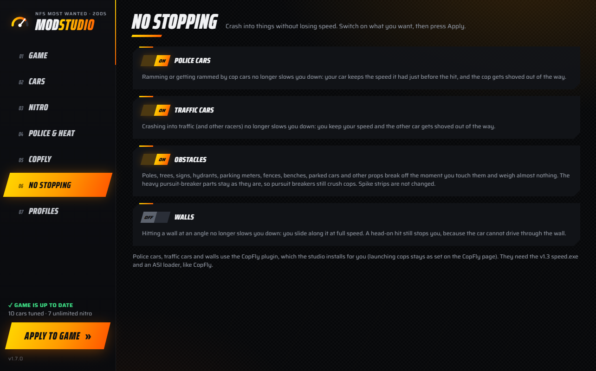
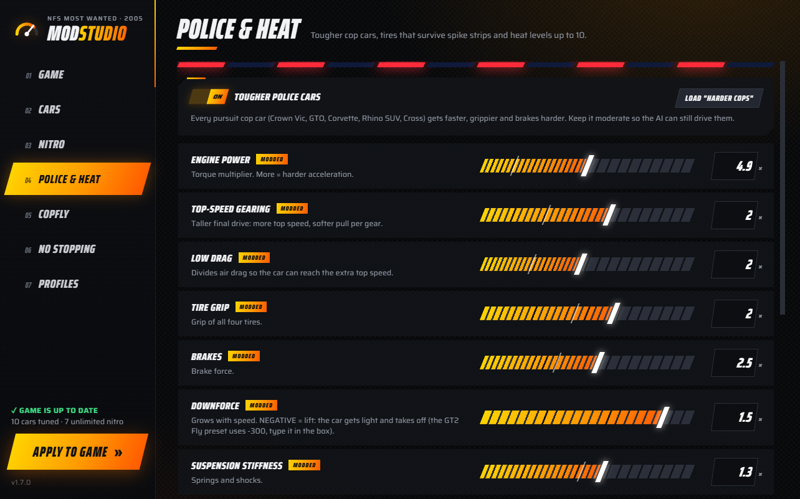
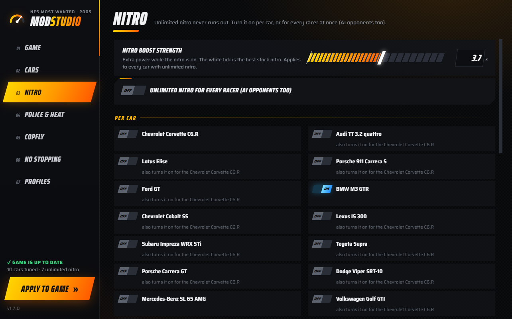

# NFSMW Mod Studio

A mod manager for Need for Speed: Most Wanted (2005, PC). Tune cars, get unlimited nitro, make the cops tougher,
raise the heat to 10, launch cop cars with CopFly and crash through things without slowing down. It backs up your
original files before it changes anything.


## Features

- Car tuning for every drivable car: power, gearing, drag, grip, brakes, downforce (negative too, so the car takes
  off), suspension, shock damping, suspension travel, rear grip, shift speed, handbrake, steering, stability and
  turn-in. A tune also applies to the fully upgraded version of the car.
- Add-on cars from [NFSMW Unlimiter](https://github.com/nlgxzef/NFSMWUnlimiter) and Binary show up with their in-game
  names. If you add a car after using the app, Apply and Restore keep it.
- Traffic vehicles, semi trucks and cop cars that are in your garage show up in the car list too. Traffic uses the
  same data, so those vehicles get the tune as well.
- Presets: Cayman Max, BMW GTR Beast, GT2 Fly, Gallardo Buff, Supra Drift, Harder Cops and RB19 Rocket (for a Red
  Bull RB19 add-on).
- Unlimited nitro per car, or for every racer at once (AI too), with adjustable boost.
- Tougher police cars (Crown Vic, GTO, Corvette, Rhino SUV, Cross).
- Spike-proof tires.
- No stopping, with a switch each for police cars, traffic cars, obstacles (poles, trees, signs, hydrants, fences,
  parked cars) and walls. Hitting them no longer slows you down. A head-on wall hit still stops you.
- Heat levels up to 10, through the settings of the free [Extra Options](https://github.com/ExOptsTeam/NFSMWExOpts/releases)
  plugin.
- CopFly: ram a cop car and it gets launched into the air. The harder you hit, the higher it goes.
- Camera, two optional switches for the driving views:
  - FOV widens with speed: the view gets wider as you speed up (12 degrees extra at about 250 km/h by default) and
    eases back when you slow down. It adds to the game's own field of view, so it works with the Widescreen Fix.
  - Smoother camera + no shake: the chase camera follows bumps and turns a little more smoothly, and the camera
    shake at speed, with nitro and on rough roads is turned down (to none by default).
- Profiles: save your setup to a .json file and share it, or load someone else's.
- Your original files are backed up once and can be restored from the Game page.

<p>
 
 

</p>

## Download and use

1. Download `NFSMW-Mod-Studio.exe` from the [Releases](../../releases) page. It's a single file, no install.
2. Run it. It finds your game folder on its own; if it doesn't, click Browse on the Game page and pick the folder
   with `speed.exe`.
3. Change what you like on the Cars, Nitro, Police & Heat, CopFly, No stopping and Camera pages, or load the Full
   Mod Pack on the Profiles page.
4. Close the game, then press Apply to game.
5. Start the game.

To undo everything, use Restore original game files on the Game page, then switch CopFly, the No stopping switches
and the Camera switches off and press Apply.

### Requirements

- Need for Speed: Most Wanted (2005) for PC on Windows 10 or 11, with the Microsoft Edge WebView2 Runtime (Windows 11
  has it already).
- Car, nitro and police mods work on any game version, stock or with NFSMW Unlimiter.
- CopFly, the No stopping switches for police cars, traffic cars and walls, and the Camera page need the v1.3
  `speed.exe` and an ASI loader. The [Widescreen Fix](https://github.com/ThirteenAG/WidescreenFixesPack/releases/tag/nfsmw) comes with the
  [Ultimate ASI Loader](https://github.com/ThirteenAG/Ultimate-ASI-Loader/releases) as `dinput8.dll`.
- Heat above 5 needs [NFSMW Extra Options](https://github.com/ExOptsTeam/NFSMWExOpts/releases). In free roam press
  F7, then PageUp to raise the heat.

The Game page checks these and links to anything missing.

## Troubleshooting

- The game closes right after starting: don't Alt-Tab or click another window while it loads. NFS MW quits if it
  loses focus during startup.
- "Windows blocked writing to the game folder": the game is probably in Program Files. Right-click the app and
  choose Run as administrator.
- Antivirus flags the exe: this happens a lot with Python apps packed by PyInstaller. You can read the source and
  [build it yourself](#build-from-source).
- Cops don't fly on fast side-swipes: raise Contact gap to 0.2 on the CopFly page.
- A car's nitro switch is greyed out: the game data can't give that car its own nitro. Use Unlimited nitro for
  every racer instead.
- Some cars share data. For example the Vauxhall Monaro uses the Pontiac GTO's engine, so tuning one changes both.
  The app tells you when that happens.
- The Camera switches do nothing: check the Camera compatibility line on the Game page. Then switch on Write a camera
  log on the Camera page, press Apply, drive for a bit and press Open log. You should see `camera: hooked` lines
  and, every 2 seconds, a `camera: mode ... speed ...` line. If it says `camera not hooked`, another plugin changed
  the same spot in `speed.exe`.
- The view is too wide or zooms in and out too much: lower Extra FOV at full speed, or raise Response time.
- The camera feels floaty: lower Smoothing. 0 keeps the stock follow but still removes the shake.
- The Camera page and the newer FusionFix free look both change the chase camera. If smoothing stops working with
  FusionFix, turn its free look off.

Backups are in `<game folder>\ModStudio\backup`. Back up your saves too (`Documents\NFS Most Wanted`) before trying
big mods.

## How it works

- Car, police, nitro and prop changes are edits to `GLOBAL\attributes.bin` (and the copy inside
  `GlobalMemoryFile.bin` when there is one). See [`app/vltdb.py`](app/vltdb.py) and [`app/tuning.py`](app/tuning.py).
- CopFly, the No stopping switches for police cars, traffic cars and walls, and the Camera switches are one ASI
  plugin, [`copfly/copfly.c`](copfly/copfly.c), for the v1.3 `speed.exe`. Its settings are in
  `scripts\NFSMWCopFly.ini` (camera settings under `[Camera]`).
- The plugin only changes `speed.exe` in memory, and only after it checks that each spot holds what it expects.
  Every address is in [`app/hooks.py`](app/hooks.py): `build.py` writes `copfly/hooks.h` from it, and the Game page
  checks your `speed.exe` against the same list.
- If another tool (like a car installer) changes the game files, the app keeps those changes in its backup.

## Build from source

```
pip install -r requirements.txt
python build.py
```

The exe ends up in `dist`. To run without building: `python app/modstudio.py`. `build.py` also compiles the CopFly
plugin into `app/copfly/` with the zig C compiler, which pip installs.

## Credits

- [ExOpts Team](https://github.com/ExOptsTeam/NFSMWExOpts): NFSMW Extra Options (heat levels).
- [nlgxzef](https://github.com/nlgxzef/NFSMWUnlimiter): NFSMW Unlimiter (add-on cars).
- [ThirteenAG](https://github.com/ThirteenAG): Widescreen Fix and Ultimate ASI Loader.
- [pywebview](https://github.com/r0x0r/pywebview): the app window.
- [Saira](https://github.com/Omnibus-Type/Saira) by Omnibus-Type: the font (SIL Open Font License, see `app/ui/fonts/OFL.txt`).
- The NFS modding community for the Attrib/VLT format research.

## License

[MIT](LICENSE). The Saira font is under the SIL Open Font License (`app/ui/fonts/OFL.txt`).

## Disclaimer

A fan-made mod tool, not affiliated with or endorsed by Electronic Arts. No game files are included, so you need
your own copy of the game. Use at your own risk. The app keeps backups, but keep your own too.
