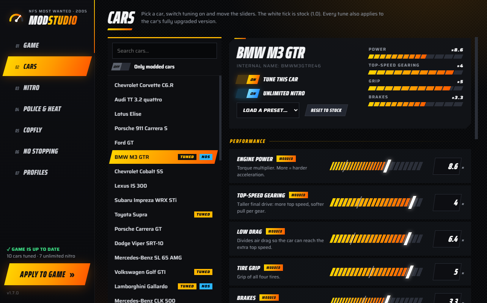
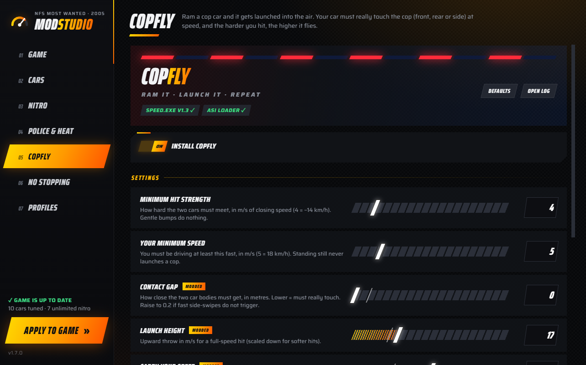
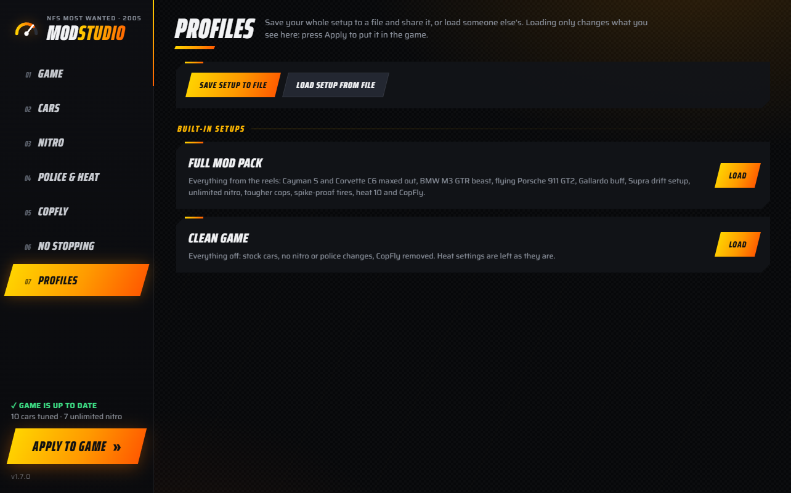

# NFSMW Mod Studio

**One app to tune any car, get unlimited nitro, make the cops tougher, push heat to 10 and launch cop cars
into the air in Need for Speed: Most Wanted (2005, PC).**

Flip a switch, move a slider, press **Apply to game**. No hex editing, no VltEd scripts, and your original
files are backed up automatically.



## Features

| | |
|---|---|
| **Car tuning** | Every drivable car: engine power, top-speed gearing, drag, grip, brakes, downforce (even *negative* downforce, so the car takes off), suspension, shock damping, suspension travel, rear grip balance, shift speed, handbrake, steering lock, stability assist and turn-in speed. Tunes also apply to the car's fully upgraded version. |
| **Add-on cars** | Cars added with [NFSMW Unlimiter](https://github.com/nlgxzef/NFSMWUnlimiter) and Binary show up under their in-game names and can be tuned like any other car. If you install one after using the studio, it notices, and Apply and Restore keep the new car. |
| **Garage extras** | Traffic vehicles, semi trucks and cop cars that are in your garage (for example a container truck) show up in the car list too. They share their data with the same vehicles in traffic, so those get the tune as well. |
| **Presets** | Cayman Max, BMW GTR Beast, GT2 Fly, Gallardo Buff, Supra Drift, Harder Cops, RB19 Rocket (made for a Red Bull RB19 add-on): load one and adjust it. |
| **Unlimited nitro** | Per car, or for every racer at once (AI too), with adjustable boost strength. |
| **Tougher police** | Every pursuit cop car (Crown Vic, GTO, Corvette, Rhino SUV, Cross) gets faster, grippier and brakes harder. |
| **Spike-proof tires** | Spike strips stop popping your tires. |
| **No stopping** | A tab with four switches. **Police cars** and **Traffic cars**: crashing into them no longer slows you down, you keep your speed and they get shoved away. **Obstacles**: poles, trees, signs, hydrants, parking meters, fences, parked cars and other props break off the moment you touch them. **Walls**: you slide along a wall at full speed (a head-on hit still stops you). |
| **Heat levels up to 10** | Edits the settings of the free [Extra Options](https://github.com/ExOptsTeam/NFSMWExOpts/releases) plugin. |
| **CopFly** | A custom plugin: ram a cop car and it gets launched into the air. It needs real contact (front, rear or side) at speed, and the launch scales with how hard you hit. |
| **Profiles** | Save your whole setup to a `.json` file and share it, or load someone else's. |
| **Safe** | Original files are backed up once and are one click away. Applying always starts from the originals, so nothing stacks or breaks. |

<p>
 
 

</p>

## Download and use

1. Download **`NFSMW-Mod-Studio.exe`** from the [Releases](../../releases) page. It's a single file; nothing to install.
2. Run it. It finds your game folder automatically; otherwise click **Browse** on the **Game** page and pick
   the folder that contains `speed.exe`.
3. Change what you like on the **Cars**, **Nitro**, **Police & Heat**, **CopFly** and **No stopping** pages, or
   load the **Full Mod Pack** on the **Profiles** page.
4. **Close the game**, then press **APPLY TO GAME**.
5. Start the game.

To undo everything: **Game** page > **Restore original game files**, and switch CopFly off then Apply.

### Requirements

- Need for Speed: Most Wanted (2005) for PC, Windows 10 or 11 (with the Microsoft Edge WebView2 Runtime, which Windows 11 has built in).
- Car, nitro and police mods work on any game version (stock or with NFSMW Unlimiter).
- **CopFly** needs the **v1.3** `speed.exe` and an **ASI loader**. The
  [Widescreen Fix](https://github.com/ThirteenAG/WidescreenFixesPack/releases/tag/nfsmw) ships the
  [Ultimate ASI Loader](https://github.com/ThirteenAG/Ultimate-ASI-Loader/releases) as `dinput8.dll`.
- **Heat above 5** needs [NFSMW Extra Options](https://github.com/ExOptsTeam/NFSMWExOpts/releases). In free
  roam press **F7**, then **PageUp** to raise the heat.

The **Game** page checks all of this for you and links to whatever is missing.

## Troubleshooting

- **The game closes right after starting:** don't Alt-Tab or click another window while it loads. NFS MW quits if
  it loses focus during startup.
- **"Windows blocked writing to the game folder":** the game is probably in `Program Files`. Right-click the
  studio > **Run as administrator**.
- **My antivirus flags the exe:** this is a common false positive for Python apps packed with PyInstaller.
  You can read the source and [build it yourself](#build-from-source).
- **Cops don't fly on fast side-swipes:** raise *Contact gap* to 0.2 on the CopFly page.
- **A car's nitro switch is greyed out:** the game data can't give that car its own nitro. Use *Unlimited
  nitro for every racer* instead.
- **Some cars share data:** for example the Vauxhall Monaro uses the Pontiac GTO's engine, so tuning one
  changes both. The studio tells you when that's the case.

Backups live in `<game folder>\ModStudio\backup`. Back up your save game too
(`Documents\NFS Most Wanted`) before trying big mods.

## How it works

- Car, police, nitro and prop changes are edits to `GLOBAL\attributes.bin` (and the copy inside
  `GlobalMemoryFile.bin` when there is one). See [`app/vltdb.py`](app/vltdb.py) and [`app/tuning.py`](app/tuning.py).
- CopFly and the No stopping switches for police cars, traffic cars and walls are an ASI plugin,
  [`copfly/copfly.c`](copfly/copfly.c), for the v1.3 `speed.exe`.
- If another tool (like a car installer) changes the game files, the studio keeps those changes in its backup.

## Build from source

```
pip install -r requirements.txt
python build.py            # -> dist/NFSMW-Mod-Studio.exe
```

To run without building: `python app/modstudio.py`. Installing CopFly from source needs the plugin, which
`build.py` compiles into `app/copfly/` using the zig C compiler (installed by pip).

## Credits

- [ExOpts Team](https://github.com/ExOptsTeam/NFSMWExOpts): NFSMW Extra Options (heat levels).
- [nlgxzef](https://github.com/nlgxzef/NFSMWUnlimiter): NFSMW Unlimiter (add-on cars).
- [ThirteenAG](https://github.com/ThirteenAG): Widescreen Fix and Ultimate ASI Loader.
- [pywebview](https://github.com/r0x0r/pywebview): the app window (Microsoft Edge WebView2).
- [Saira](https://github.com/Omnibus-Type/Saira) by Omnibus-Type: the font (SIL Open Font License, see `app/ui/fonts/OFL.txt`).
- The NFS modding community for the Attrib/VLT format research.

## License

[MIT](LICENSE). The Saira font is under the SIL Open Font License (`app/ui/fonts/OFL.txt`).

## Disclaimer

A fan-made mod tool. It isn't affiliated with or endorsed by Electronic Arts. **No game files are included**:
you need your own copy of the game. Use at your own risk; the studio keeps backups, but keep your own too.
